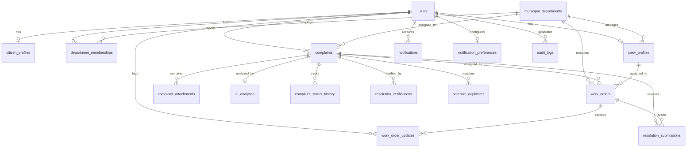

# CivicFix AI — Database Architecture & Schema Specification

This document details the PostgreSQL / PostGIS and SQLite database architecture for CivicFix AI, covering all 18 normalized tables, entity relationships, data constraints, spatial indexing, and dual-engine compatibility.

---

## 1. Database Architecture Overview

CivicFix AI uses a normalized relational architecture designed for high transactional integrity, strict role-based access control, and geospatial querying:

- **Primary Production Database**: PostgreSQL 16 with PostGIS 3.4 extensions for geospatial indexing (`ST_DWithin`, `ST_MakePoint`, `ST_DistanceSphere`).
- **Development & Test Database**: SQLite with in-memory / file-based persistence (`civicfix.db`) and custom Python-level Haversine trigonometric functions registered for spatial calculations.
- **ORM & Migrations**: SQLAlchemy 2.0 (Declarative Base, Mapped type annotations) with Alembic migration versioning.



---

## 2. Table Specifications (All 18 Normalized Entities)

### 2.1 Core Identity & Access Control

#### `users`
Central authentication identity table. Enforces role boundaries and credentials.
- `id` (VARCHAR(36), PK): UUIDv4 string.
- `email` (VARCHAR(255), UNIQUE, NOT NULL, INDEXED): Normalized citizen or staff email.
- `hashed_password` (VARCHAR(255), NOT NULL): Argon2id cryptographically hashed password.
- `full_name` (VARCHAR(255), NOT NULL): User display name.
- `phone_number` (VARCHAR(30), NULL): Contact phone for SMS/notifications.
- `role` (VARCHAR(32), NOT NULL, INDEXED): Enum (`CITIZEN`, `MUNICIPAL_MEMBER`, `FIELD_CREW`, `GOVERNMENT_ADMIN`).
- `is_active` (BOOLEAN, DEFAULT TRUE): Account active flag.
- `is_verified` (BOOLEAN, DEFAULT FALSE): Email verification flag.
- `created_at` (TIMESTAMP WITH TIME ZONE, NOT NULL): UTC creation timestamp.
- `updated_at` (TIMESTAMP WITH TIME ZONE, NOT NULL): UTC last update timestamp.
- *Constraint*: Only 1 active record with `role = 'GOVERNMENT_ADMIN'` permitted in the system.

#### `citizen_profiles`
Extended profile for public reporting citizens.
- `id` (VARCHAR(36), PK): UUIDv4 string.
- `user_id` (VARCHAR(36), FK -> `users.id`, UNIQUE, NOT NULL, CASCADE ON DELETE).
- `ward_number` (VARCHAR(50), NULL): Municipal ward identifier.
- `address` (TEXT, NULL): Street address.
- `trust_score` (FLOAT, DEFAULT 1.0): Dynamic civic reputation score (0.0 to 1.0).
- `anonymous_preferred` (BOOLEAN, DEFAULT FALSE): Anonymize name on public boards.

#### `municipal_departments`
Municipal departments responsible for resolving specific categories of civic complaints.
- `id` (VARCHAR(36), PK): UUIDv4 string.
- `name` (VARCHAR(150), UNIQUE, NOT NULL): E.g., "Roads & Bridges", "Public Health & Sanitation".
- `code` (VARCHAR(32), UNIQUE, NOT NULL): E.g., `ROADS`, `SANITATION`, `ELECTRICAL`, `WATER`.
- `description` (TEXT, NULL): Scope of departmental responsibilities.
- `contact_email` (VARCHAR(255), NULL): Official department inquiry email.
- `is_active` (BOOLEAN, DEFAULT TRUE): Active department flag.
- `created_at` (TIMESTAMP WITH TIME ZONE, NOT NULL).

#### `department_memberships`
Links administrative staff and municipal officers to their respective department with granular permissions.
- `id` (VARCHAR(36), PK): UUIDv4 string.
- `user_id` (VARCHAR(36), FK -> `users.id`, UNIQUE, NOT NULL, CASCADE ON DELETE).
- `department_id` (VARCHAR(36), FK -> `municipal_departments.id`, NOT NULL).
- `title` (VARCHAR(100), NOT NULL): Job title (e.g., "Superintending Engineer", "Zonal Officer").
- `permissions` (JSON, DEFAULT '[]'): Fine-grained permission flags (`can_assign`, `can_override_ai`, `can_export`).
- `created_at` (TIMESTAMP WITH TIME ZONE, NOT NULL).

#### `crew_profiles`
Operational field maintenance teams and crew leaders.
- `id` (VARCHAR(36), PK): UUIDv4 string.
- `user_id` (VARCHAR(36), FK -> `users.id`, UNIQUE, NOT NULL, CASCADE ON DELETE).
- `department_id` (VARCHAR(36), FK -> `municipal_departments.id`, NOT NULL).
- `skills` (JSON, DEFAULT '[]'): Equipment and specialization tags (e.g., `["asphalt", "heavy_machinery"]`).
- `vehicle_number` (VARCHAR(50), NULL): Maintenance truck registration.
- `current_status` (VARCHAR(32), DEFAULT 'AVAILABLE'): `AVAILABLE`, `ASSIGNED`, `ON_LEAVE`.
- `created_at` (TIMESTAMP WITH TIME ZONE, NOT NULL).

---

### 2.2 Complaint Management & AI Pipeline

#### `complaints`
Primary civic complaint ticket record with geographic coordinates.
- `id` (VARCHAR(36), PK): UUIDv4 string.
- `tracking_number` (VARCHAR(32), UNIQUE, NOT NULL, INDEXED): Human-readable tracking ID (e.g., `CF-2026-0001`).
- `citizen_id` (VARCHAR(36), FK -> `users.id`, NOT NULL, INDEXED): Submitting citizen.
- `title` (VARCHAR(255), NOT NULL): Complaint summary.
- `description` (TEXT, NOT NULL): Detailed problem narrative.
- `category` (VARCHAR(64), NOT NULL, INDEXED): Problem category (e.g., `POTHOLE`, `STREETLIGHT`, `GARBAGE`).
- `severity` (VARCHAR(16), DEFAULT 'MEDIUM'): Submitter-selected severity (`LOW`, `MEDIUM`, `HIGH`, `CRITICAL`).
- `status` (VARCHAR(32), DEFAULT 'SUBMITTED', INDEXED): State enum (`SUBMITTED`, `AI_TRIAGED`, `DEPARTMENT_ASSIGNED`, `CREW_ASSIGNED`, `IN_PROGRESS`, `AWAITING_CITIZEN_CONFIRMATION`, `RESOLVED`, `REOPENED`, `REJECTED`, `FLAGGED_DUPLICATE`).
- `latitude` (FLOAT, NOT NULL): WGS84 decimal latitude (-90.0 to +90.0).
- `longitude` (FLOAT, NOT NULL): WGS84 decimal longitude (-180.0 to +180.0).
- `address_text` (TEXT, NULL): Reverse-geocoded or citizen-provided landmark address.
- `assigned_department_id` (VARCHAR(36), FK -> `municipal_departments.id`, NULL, INDEXED).
- `sla_deadline` (TIMESTAMP WITH TIME ZONE, NULL): Dynamically calculated SLA deadline.
- `is_emergency` (BOOLEAN, DEFAULT FALSE): Immediate public safety hazard flag.
- `created_at` (TIMESTAMP WITH TIME ZONE, NOT NULL, INDEXED).
- `updated_at` (TIMESTAMP WITH TIME ZONE, NOT NULL).

#### `complaint_attachments`
Photographs, documents, or audio evidence uploaded during submission.
- `id` (VARCHAR(36), PK): UUIDv4 string.
- `complaint_id` (VARCHAR(36), FK -> `complaints.id`, NOT NULL, CASCADE ON DELETE).
- `file_url` (VARCHAR(500), NOT NULL): Sanitized server relative URL.
- `file_name` (VARCHAR(255), NOT NULL): Original client filename.
- `mime_type` (VARCHAR(64), NOT NULL): Strict MIME type (`image/jpeg`, `image/png`, `image/webp`).
- `file_size_bytes` (INTEGER, NOT NULL): File size in bytes (max 10MB).
- `uploaded_at` (TIMESTAMP WITH TIME ZONE, NOT NULL).

#### `ai_analyses`
Structured machine learning inference result attached to each complaint.
- `id` (VARCHAR(36), PK): UUIDv4 string.
- `complaint_id` (VARCHAR(36), FK -> `complaints.id`, UNIQUE, NOT NULL, CASCADE ON DELETE).
- `detected_category` (VARCHAR(64), NOT NULL): NLP predicted category.
- `category_confidence` (FLOAT, NOT NULL): Classification probability (0.00 to 1.00).
- `damage_severity_score` (FLOAT, NOT NULL): Computer vision physical damage assessment (1.0 to 10.0).
- `suggested_priority` (VARCHAR(16), NOT NULL): Recommended urgency (`P1`, `P2`, `P3`, `P4`).
- `priority_justification` (TEXT, NOT NULL): Natural language explainability reasoning.
- `suggested_department_code` (VARCHAR(32), NOT NULL): Recommended routing code.
- `confidence_score` (FLOAT, NOT NULL): Overall triage pipeline confidence.
- `model_version` (VARCHAR(64), NOT NULL): ML model identifier (e.g., `CivicFix-NLP-Vision-v2.1`).
- `analyzed_at` (TIMESTAMP WITH TIME ZONE, NOT NULL).

#### `complaint_status_history`
Immutable chronological audit log of all ticket state transitions.
- `id` (VARCHAR(36), PK): UUIDv4 string.
- `complaint_id` (VARCHAR(36), FK -> `complaints.id`, NOT NULL, CASCADE ON DELETE).
- `previous_status` (VARCHAR(32), NULL): Pre-transition state.
- `new_status` (VARCHAR(32), NOT NULL): Target state.
- `changed_by_user_id` (VARCHAR(36), FK -> `users.id`, NULL): Actor responsible.
- `change_reason` (TEXT, NULL): Justification or citizen dispute explanation.
- `changed_at` (TIMESTAMP WITH TIME ZONE, NOT NULL).

#### `potential_duplicates`
Geographic and semantic duplicate candidates detected by the AI triage engine.
- `id` (VARCHAR(36), PK): UUIDv4 string.
- `complaint_id` (VARCHAR(36), FK -> `complaints.id`, NOT NULL): Incoming complaint.
- `duplicate_of_id` (VARCHAR(36), FK -> `complaints.id`, NOT NULL): Existing open parent ticket.
- `similarity_score` (FLOAT, NOT NULL): Combined confidence score (0.00 to 1.00).
- `distance_meters` (FLOAT, NOT NULL): Haversine / PostGIS spatial distance in meters.
- `is_confirmed` (BOOLEAN, DEFAULT FALSE): Admin confirmed duplicate.
- `created_at` (TIMESTAMP WITH TIME ZONE, NOT NULL).

---

### 2.3 Operations & Two-Stage Verification

#### `work_orders`
Actionable dispatch orders assigned to field crews by municipal officers.
- `id` (VARCHAR(36), PK): UUIDv4 string.
- `work_order_number` (VARCHAR(32), UNIQUE, NOT NULL, INDEXED): E.g., `WO-2026-0001`.
- `complaint_id` (VARCHAR(36), FK -> `complaints.id`, NOT NULL).
- `department_id` (VARCHAR(36), FK -> `municipal_departments.id`, NOT NULL).
- `assigned_crew_user_id` (VARCHAR(36), FK -> `users.id`, NOT NULL, INDEXED).
- `assigned_by_user_id` (VARCHAR(36), FK -> `users.id`, NOT NULL).
- `status` (VARCHAR(32), DEFAULT 'ASSIGNED'): `ASSIGNED`, `IN_PROGRESS`, `BLOCKED`, `COMPLETED`.
- `instructions` (TEXT, NULL): Special municipal directives or safety instructions.
- `priority` (VARCHAR(16), DEFAULT 'P2'): Work order priority.
- `scheduled_date` (TIMESTAMP WITH TIME ZONE, NULL).
- `started_at` (TIMESTAMP WITH TIME ZONE, NULL).
- `completed_at` (TIMESTAMP WITH TIME ZONE, NULL).
- `created_at` (TIMESTAMP WITH TIME ZONE, NOT NULL).

#### `work_order_updates`
Field progress logs, material receipts, and site condition notes.
- `id` (VARCHAR(36), PK): UUIDv4 string.
- `work_order_id` (VARCHAR(36), FK -> `work_orders.id`, NOT NULL, CASCADE ON DELETE).
- `crew_user_id` (VARCHAR(36), FK -> `users.id`, NOT NULL).
- `status_update` (VARCHAR(32), NOT NULL): Status at time of update.
- `notes` (TEXT, NOT NULL): Field report commentary.
- `photo_url` (VARCHAR(500), NULL): Progress or blocker evidence image.
- `created_at` (TIMESTAMP WITH TIME ZONE, NOT NULL).

#### `resolution_submissions` (Stage 1 Resolution)
Field crew proof-of-work submission moving ticket to `AWAITING_CITIZEN_CONFIRMATION`.
- `id` (VARCHAR(36), PK): UUIDv4 string.
- `complaint_id` (VARCHAR(36), FK -> `complaints.id`, NOT NULL).
- `work_order_id` (VARCHAR(36), FK -> `work_orders.id`, NULL).
- `submitted_by_user_id` (VARCHAR(36), FK -> `users.id`, NOT NULL).
- `resolution_notes` (TEXT, NOT NULL): Description of physical repair executed.
- `before_photo_url` (VARCHAR(500), NULL): Site photograph prior to repair.
- `after_photo_url` (VARCHAR(500), NOT NULL): Photographic evidence of finished repair.
- `materials_used` (JSON, DEFAULT '[]'): Inventory items expended (e.g., `["2 bags asphalt", "1 seal binder"]`).
- `submitted_at` (TIMESTAMP WITH TIME ZONE, NOT NULL).

#### `resolution_verifications` (Stage 2 Verification)
Citizen confirmation or dispute closing the accountability loop.
- `id` (VARCHAR(36), PK): UUIDv4 string.
- `complaint_id` (VARCHAR(36), FK -> `complaints.id`, NOT NULL).
- `verified_by_user_id` (VARCHAR(36), FK -> `users.id`, NOT NULL): Must match original reporting citizen (IDOR protected).
- `is_satisfied` (BOOLEAN, NOT NULL): TRUE = Confirmed `RESOLVED`, FALSE = Contested `REOPENED`.
- `feedback_rating` (INTEGER, NULL): 1-5 star citizen satisfaction rating.
- `citizen_comments` (TEXT, NULL): Citizen's resolution feedback or reopening rationale.
- `contest_reason` (TEXT, NULL): Explicit explanation when reopening an incomplete repair.
- `verified_at` (TIMESTAMP WITH TIME ZONE, NOT NULL).

---

### 2.4 Notifications, Auditing & Configuration

#### `notifications`
In-app notification records for all account types.
- `id` (VARCHAR(36), PK): UUIDv4 string.
- `user_id` (VARCHAR(36), FK -> `users.id`, NOT NULL, INDEXED, CASCADE ON DELETE).
- `title` (VARCHAR(255), NOT NULL): Notification header.
- `message` (TEXT, NOT NULL): Detailed alert narrative.
- `type` (VARCHAR(32), NOT NULL): `STATUS_CHANGE`, `ASSIGNMENT`, `RESOLUTION_SUBMITTED`, `DUPLICATE_FLAGGED`.
- `complaint_id` (VARCHAR(36), FK -> `complaints.id`, NULL).
- `is_read` (BOOLEAN, DEFAULT FALSE, INDEXED).
- `created_at` (TIMESTAMP WITH TIME ZONE, NOT NULL).

#### `notification_preferences`
Per-user notification delivery toggles.
- `id` (VARCHAR(36), PK): UUIDv4 string.
- `user_id` (VARCHAR(36), FK -> `users.id`, UNIQUE, NOT NULL, CASCADE ON DELETE).
- `email_enabled` (BOOLEAN, DEFAULT TRUE).
- `sms_enabled` (BOOLEAN, DEFAULT FALSE).
- `push_enabled` (BOOLEAN, DEFAULT TRUE).

#### `audit_logs`
Cryptographically traceable, immutable audit log for compliance.
- `id` (VARCHAR(36), PK): UUIDv4 string.
- `user_id` (VARCHAR(36), FK -> `users.id`, NULL, INDEXED).
- `action` (VARCHAR(64), NOT NULL, INDEXED): E.g., `LOGIN_SUCCESS`, `CREATE_COMPLAINT`, `AI_OVERRIDE`, `ASSIGN_CREW`, `VERIFY_RESOLUTION`.
- `resource_type` (VARCHAR(64), NOT NULL): `complaint`, `work_order`, `user`, `department`.
- `resource_id` (VARCHAR(36), NULL): Impacted entity ID.
- `ip_address` (VARCHAR(45), NULL): Client IP (IPv4 or IPv6).
- `details` (JSON, DEFAULT '{}'): Contextual parameters, diffs, or overrides.
- `created_at` (TIMESTAMP WITH TIME ZONE, NOT NULL, INDEXED).

#### `system_settings`
Configurable municipal operational parameters.
- `key` (VARCHAR(64), PK): E.g., `sla_p1_hours`, `duplicate_radius_meters`.
- `value` (TEXT, NOT NULL): Value string or JSON payload.
- `description` (TEXT, NULL).
- `updated_at` (TIMESTAMP WITH TIME ZONE, NOT NULL).

---

## 3. Spatial Queries & PostGIS Integration

### Production Spatial Indexing (PostgreSQL + PostGIS)
In production, spatial duplicate detection queries use PostGIS geometric points with a GiST spatial index:

```sql
-- Create spatial column from coordinates
ALTER TABLE complaints ADD COLUMN geom geometry(Point, 4326);
UPDATE complaints SET geom = ST_SetSRID(ST_MakePoint(longitude, latitude), 4326);

-- GiST spatial index for sub-millisecond proximity lookups
CREATE INDEX idx_complaints_geom ON complaints USING GIST(geom);

-- Find active complaints within 100 meters of a new complaint
SELECT id, tracking_number, category, status,
       ST_DistanceSphere(geom, ST_SetSRID(ST_MakePoint(:new_lng, :new_lat), 4326)) AS distance_meters
FROM complaints
WHERE status NOT IN ('RESOLVED', 'REJECTED')
  AND ST_DWithin(
        geom::geography,
        ST_SetSRID(ST_MakePoint(:new_lng, :new_lat), 4326)::geography,
        100.0
      );
```

### Local Development & Testing Compatibility (Haversine Engine)
In SQLite mode, the system automatically uses spherical trigonometry with degree-to-radian conversion (`app/services/maps/spatial.py`):

$$\Delta\sigma = 2 \arcsin \left( \sqrt{ \sin^2\left(\frac{\Delta\phi}{2}\right) + \cos(\phi_1)\cos(\phi_2)\sin^2\left(\frac{\Delta\lambda}{2}\right) } \right)$$
$$d = R \cdot \Delta\sigma \quad (R = 6,371,000 \text{ meters})$$

This ensures 100% test pass rate in lightweight environments without requiring a local PostGIS installation.

