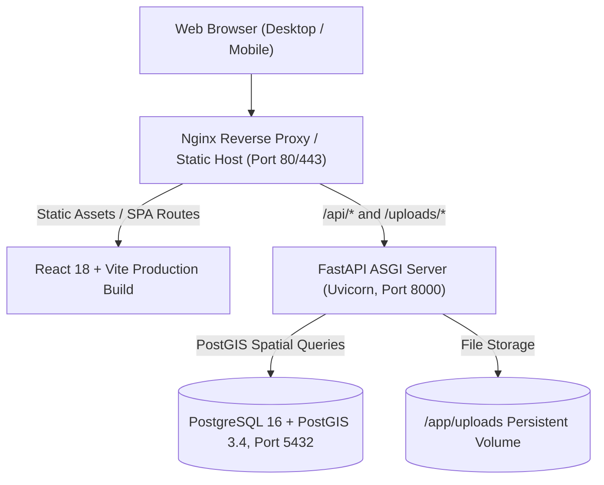

# CivicFix AI — Deployment & Infrastructure Guide

This guide provides instructions for deploying CivicFix AI across development, testing, and production environments.

---

## 1. System Topology

CivicFix AI is designed as a cloud-native, containerized multi-tier application:



---

## 2. Environment Configuration

Copy the example environment file and customize your secrets:

```bash
cp .env.example .env
```

### Key Configuration Variables

| Variable | Description | Default / Example |
| :--- | :--- | :--- |
| `ENVIRONMENT` | Environment mode (`development` / `production`) | `development` |
| `DATABASE_URL` | SQLAlchemy connection string | `sqlite:///./civicfix.db` (local) or `postgresql+psycopg2://civicfix:secret@db:5432/civicfix_db` (docker) |
| `JWT_SECRET_KEY` | 256-bit cryptographically secure secret key | Generate with `openssl rand -hex 32` |
| `ACCESS_TOKEN_EXPIRE_MINUTES` | Access token lifespan | `15` |
| `REFRESH_TOKEN_EXPIRE_DAYS` | Refresh token lifespan | `7` |
| `UPLOAD_DIR` | Local disk folder for file attachments | `./uploads` |
| `MAX_UPLOAD_SIZE_BYTES` | Maximum allowed attachment size in bytes | `10485760` (10 MB) |
| `INITIAL_ADMIN_EMAIL` | Super-admin email for bootstrap CLI | `admin@civicfix.gov` |
| `INITIAL_ADMIN_PASSWORD` | Super-admin password for bootstrap CLI | `CivicFixAdmin2026!` |
| `INITIAL_ADMIN_NAME` | Super-admin full name | `Government Administrator` |

---

## 3. Local Development Setup (Quickstart)

### Prerequisites
- Python 3.12+ (CPython recommended)
- Node.js 18+ & npm
- Git

### Backend Setup
1. Open a terminal in the project root:
   ```powershell
   # 1. Create and activate virtual environment
   python -m venv backend/.venv
   .\backend\.venv\Scripts\Activate.ps1

   # 2. Install backend dependencies
   pip install -r backend/requirements.txt

   # 3. Provision the initial Government Admin
   python backend/bootstrap.py --email admin@civicfix.gov --password "CivicFixAdmin2026!" --name "Chief Municipal Administrator"

   # 4. Seed demo departments, staff, and initial complaints
   python backend/seed.py

   # 5. Run backend automated test suite
   pytest backend/tests/test_civicfix.py

   # 6. Start backend development server
   uvicorn app.main:app --host 127.0.0.1 --port 8000 --reload --app-dir backend
   ```
   FastAPI will be accessible at:
   - API Server: `http://127.0.0.1:8000`
   - Interactive OpenAPI Docs: `http://127.0.0.1:8000/docs`
   - Healthcheck: `http://127.0.0.1:8000/health`

### Frontend Setup
1. Open a secondary terminal:
   ```powershell
   cd frontend

   # 1. Install dependencies
   npm install

   # 2. Run vitest unit tests
   npm test

   # 3. Test production build
   npm run build

   # 4. Start local development server
   npm run dev
   ```
   The React application will be accessible at: `http://localhost:5173`.

---

## 4. Containerized Production Deployment (Docker Compose)

For production deployments on Linux/Cloud servers with real PostgreSQL 16 and PostGIS 3.4:

### 1. Build and Launch Containers
```bash
docker compose -f infrastructure/docker-compose.yml up --build -d
```

This starts three orchestrated services:
1. `civicfix-db`: PostgreSQL 16 with PostGIS 3.4 (`postgis/postgis:16-3.4`).
2. `civicfix-backend`: Python 3.12 FastAPI application served by Uvicorn.
3. `civicfix-frontend`: Nginx reverse proxy serving the compiled React bundle and proxying `/api/*` to the backend.

### 2. Initialize Database & Seed
Run the bootstrap and seeder directly inside the backend container:
```bash
# Provision initial Government Admin (Single-Admin Invariant)
docker compose -f infrastructure/docker-compose.yml exec backend python bootstrap.py --email admin@civicfix.gov --password "CivicFixAdmin2026!" --name "Municipal Super Admin"

# Seed default departments, staff, and sample civic issues
docker compose -f infrastructure/docker-compose.yml exec backend python seed.py
```

### 3. Verify Health & Status
```bash
# Verify container health
docker compose -f infrastructure/docker-compose.yml ps

# Inspect logs
docker compose -f infrastructure/docker-compose.yml logs -f
```
The public portal will be accessible at `http://localhost:80` (or your domain).

---

## 5. Production Cloud Deployment (Render + Vercel)

### Architecture
- **Backend & Database**: Render Web Service + PostgreSQL Database using `render.yaml` Blueprint.
- **Frontend**: Vercel Static/SPA Deployment with client-side rewrites using `frontend/vercel.json`.

### Render Deployment
1. Connect GitHub repository in Render Dashboard.
2. Select **New Blueprint Instance** and pick `render.yaml`.
3. Render automatically provisions:
   - `civicfix-postgres`: Managed PostgreSQL instance.
   - `civicfix-backend`: Python 3.12 FastAPI service with Uvicorn.
4. Auto-runs `bootstrap.py` (admin setup) and `seed.py` (demo departments and data).
5. Healthcheck probed at `/health`.

### Vercel Deployment
1. Import GitHub repository into Vercel.
2. Root directory: `frontend`.
3. Build command: `npm run build`.
4. Output directory: `dist`.
5. Environment variable: `VITE_API_BASE_URL` pointing to Render backend URL.

---

## 6. Seeded Accounts & Credentials

The seed script creates the following demo credentials across all four roles:

| Role | Email | Password | Display Name & Notes |
| :--- | :--- | :--- | :--- |
| **`GOVERNMENT_ADMIN`** | `admin@civicfix.gov` | `AdminSecure2026!` | Municipal Administrator (Full instance rights) |
| **`MUNICIPAL_MEMBER`** | `officer.sharma@civicfix.gov` | `StaffSecure2026!` | Rajesh Sharma (Roads & Bridges Department) |
| **`FIELD_CREW`** | `crew.patel@civicfix.gov` | `CrewSecure2026!` | Vikas Patel (Road Maintenance Field Unit) |
| **`CITIZEN`** | `citizen.arjun@example.com` | `CitizenPass2026!` | Arjun Reddy (Citizen Reporter, Jubilee Enclave) |
| **`CITIZEN`** | `citizen.priya@example.com` | `CitizenPass2026!` | Priya Nair (Citizen Reporter, Green Meadows) |

---

## 7. Production Hardening Checklist

Prior to public deployment:
- [ ] Set `ENVIRONMENT=production` in `.env`.
- [ ] Replace `JWT_SECRET_KEY` with a cryptographically generated 256-bit secret.
- [ ] Configure SSL/TLS termination via Let's Encrypt / Certbot on Nginx.
- [ ] Set up daily automated PostgreSQL backups via `pg_dump`.
- [ ] Mount AWS S3, Cloudflare R2, or Google Cloud Storage adapter for `uploads/`.
- [ ] Ensure rate-limiting thresholds on `/api/v1/auth/login` are configured for your traffic profile.

