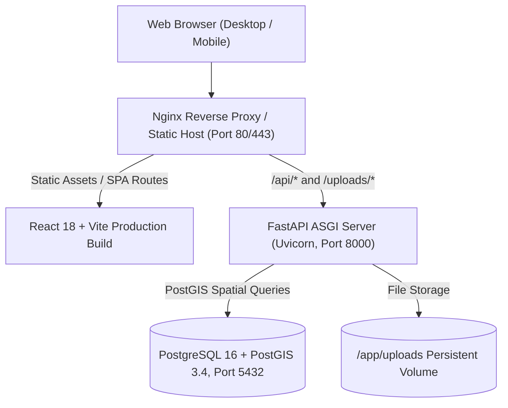

# CivicFix AI — Deployment & Infrastructure Guide

This guide provides instructions for deploying CivicFix AI across development, testing, and production environments.

---

## 1. System Topology

CivicFix AI is designed as a cloud-native, containerized multi-tier application:



---

## 2. Environment Configuration

Copy the example environment file and customize your secrets:

```bash
cp .env.example .env
```

### Key Configuration Variables

| Variable | Description | Default / Example |
| :--- | :--- | :--- |
| `ENVIRONMENT` | Environment mode (`development` / `production`) | `development` |
| `DATABASE_URL` | SQLAlchemy connection string | `sqlite:///./civicfix.db` (local) or `postgresql+psycopg2://civicfix:secret@db:5432/civicfix_db` (docker) |
| `JWT_SECRET_KEY` | 256-bit cryptographically secure secret key | Generate with `openssl rand -hex 32` |
| `ACCESS_TOKEN_EXPIRE_MINUTES` | Access token lifespan | `15` |
| `REFRESH_TOKEN_EXPIRE_DAYS` | Refresh token lifespan | `7` |
| `UPLOAD_DIR` | Local disk folder for file attachments | `./uploads` |
| `MAX_UPLOAD_SIZE_BYTES` | Maximum allowed attachment size in bytes | `10485760` (10 MB) |
| `INITIAL_ADMIN_EMAIL` | Super-admin email for bootstrap CLI | `admin@civicfix.gov` |
| `INITIAL_ADMIN_PASSWORD` | Super-admin password supplied via protected env var | *(Required secret, min 8 chars — set via secret store)* |
| `INITIAL_ADMIN_NAME` | Super-admin full name | `Municipal Commissioner` |

---

## 3. Local Development Setup (Quickstart)

### Prerequisites
- Python 3.12+ (CPython recommended)
- Node.js 18+ & npm
- Git

### Backend Setup
1. Open a terminal in the project root:
   ```powershell
   # 1. Create and activate virtual environment
   python -m venv backend/.venv
   .\backend\.venv\Scripts\Activate.ps1

   # 2. Install backend dependencies
   pip install -r backend/requirements.txt

   # 3. Run Alembic schema migrations
   python backend/migrate.py

   # 4. Provision the initial Government Admin (pass secret via env or CLI flag)
   python backend/bootstrap.py --email admin@civicfix.gov --password "<STRONG_ADMIN_PASSWORD>" --name "Chief Municipal Administrator"

   # 5. Optional opt-in demo data for local development only
   ALLOW_DEMO_SEEDING=true python backend/seed.py --demo-seed

   # 6. Run backend automated test suite
   pytest backend/tests/ -v

   # 7. Start backend development server
   uvicorn app.main:app --host 127.0.0.1 --port 8000 --reload --app-dir backend
   ```
   FastAPI will be accessible at:
   - API Server: `http://127.0.0.1:8000`
   - Interactive OpenAPI Docs: `http://127.0.0.1:8000/docs`
   - Healthcheck: `http://127.0.0.1:8000/health`

### Frontend Setup
1. Open a secondary terminal:
   ```powershell
   cd frontend

   # 1. Install dependencies
   npm install

   # 2. Run vitest unit tests
   npm test

   # 3. Test production build
   npm run build

   # 4. Start local development server
   npm run dev
   ```
   The React application will be accessible at: `http://localhost:5173`.

---

## 4. Containerized Production Deployment (Docker Compose)

For production deployments on Linux/Cloud servers with real PostgreSQL 16 and PostGIS 3.4:

### 1. Build and Launch Containers
```bash
docker compose -f infrastructure/docker-compose.yml up --build -d
```

This starts four orchestrated services (or configure external R2):
1. `civicfix-db`: PostgreSQL 16 with PostGIS 3.4 (`postgis/postgis:16-3.4`).
2. `civicfix-redis`: Redis 7.2 for ARQ background jobs and shared rate-limiting.
3. `civicfix-backend`: Python 3.12 FastAPI application served by Uvicorn.
4. `civicfix-worker`: Dedicated Python background worker (`python worker.py`) executing AI triage, email outbox, and periodic SLA checks.
5. `civicfix-frontend`: Nginx reverse proxy serving the compiled React bundle and proxying `/api/*` to the backend.

### 2. Initialize Database
Apply migrations and optionally provision the initial admin using secrets from your `.env`:
```bash
docker compose -f infrastructure/docker-compose.yml exec backend python migrate.py
docker compose -f infrastructure/docker-compose.yml exec backend python bootstrap.py --email admin@civicfix.gov --password "$INITIAL_ADMIN_PASSWORD" --name "Municipal Super Admin"
# Optional dev demo seeding only:
docker compose -f infrastructure/docker-compose.yml exec -e ALLOW_DEMO_SEEDING=true backend python seed.py --demo-seed
```

### 3. Verify Health & Status
```bash
# Verify container health
docker compose -f infrastructure/docker-compose.yml ps

# Inspect logs
docker compose -f infrastructure/docker-compose.yml logs -f
```
The public portal will be accessible at `http://localhost:80` (or your domain).

---

## 5. Production Cloud Deployment (Render + Vercel)

### Architecture
- **Backend & Database**: Render Web Service (`civicfix-bac`) + PostgreSQL Database (`civicfix-postgres`) using `render.yaml` Blueprint.
- **Frontend**: Vercel multi-service / SPA deployment configured at the repository root (`vercel.json`) with Vite (`frontend/vite.config.ts`).

### Render Deployment
1. Connect GitHub repository in Render Dashboard.
2. Select **New Blueprint Instance** and pick `render.yaml`.
3. Render automatically provisions:
   - `civicfix-postgres`: Managed PostgreSQL instance (`free` plan in blueprint).
   - `civicfix-bac`: Python 3.12 FastAPI service with Uvicorn (`free` plan in blueprint).
4. Start command runs `python migrate.py`, executes conditional `bootstrap.py` when `INITIAL_ADMIN_PASSWORD` is provided (production never auto-runs `seed.py`), and starts `uvicorn app.main:app`.
5. Healthcheck probed at `/health` (and diagnostics at `/health/db` and `/health/queue`).

### Vercel Deployment
1. Import GitHub repository into Vercel (or deploy using root `vercel.json`).
2. Frontend build directory: `frontend` (`npm run build` -> `dist`).
3. Set `VITE_API_BASE_URL` (or `VITE_API_URL`) to the deployed backend origin if deploying frontend standalone; never expose server-only credentials (`SECRET_KEY`, `DATABASE_URL`, `R2_*`, `REDIS_URL`, `GOOGLE_API_KEY`, `SMTP_PASSWORD`) in `VITE_*` variables.

### Render Worker Hosting Options
Because Render Free Web Services (`plan: free`) do not include Render Background Workers (`type: worker` requires a paid plan), choose one of the following worker topologies for `python worker.py` before enabling `QUEUE_BACKEND=redis` in production:
1. **Option A — Render Background Worker (`render.yaml` `type: worker`, paid plan)**: Uncomment the `civicfix-worker` service in `render.yaml` (`startCommand: "python worker.py"`) connected to the same managed PostgreSQL (`DATABASE_URL`) and external Redis (`REDIS_URL`). Provides managed restarts and log streaming inside the same Render Blueprint.
2. **Option B — External Containerized Worker (`infrastructure/docker-compose.yml` `worker` service or external container host)**: Run `python worker.py` from `backend/Dockerfile` in a separate container platform connected over TLS to the same managed PostgreSQL and Redis instances. Keeps web hosting decoupled from background worker scaling.
3. **Option C — In-Process Fallback (`QUEUE_BACKEND=inline`, non-durable / dev only)**: Executes outbox jobs inside the web process via `BackgroundTasks` without a separate worker. In `ENVIRONMENT=production`, `/health`, `/health/queue`, and `/api/v1/admin/queue/status` explicitly report `status: "degraded"` and `durable_queue: false` because jobs in memory do not survive container restarts or deploys.

### Production Migration Order & Rollback Runbook
Exact Alembic revision chain through Phase 2:
`6b691e58bfaa` -> `adca60ea77e0` -> `b4e2d9c1f8a3` (Phase 1 baseline & ownership) -> `d1a4e8c2f109` (attachment storage metadata & PostGIS check) -> `d2b5f9d3a218` (PostGIS `geography(Point, 4326)` + `ix_complaints_location_gist`) -> `d3c6a0e4b327` (`background_jobs` + `sla_breach_events`) -> `d4d7b1f5c436` (complaint resolution proof & notification metadata)

Recommended release sequence:
1. Take a pre-migration database snapshot (`pg_dump --format=custom --no-owner --file=pre_phase2_backup.dump "$DATABASE_URL"`).
2. Preview SQL offline if needed (`alembic upgrade 6b691e58bfaa:head --sql`) and ensure PostgreSQL has `postgis` available (`CREATE EXTENSION IF NOT EXISTS postgis;`).
3. Run `python migrate.py` (which detects unstamped Phase 1/Phase 2 schemas automatically and upgrades cleanly to `d4d7b1f5c436`).
4. Backfill any existing local uploads to Cloudflare R2 (`python backend/scripts/migrate_uploads_to_r2.py` dry-run first, then `--execute`).
5. **Rollback**: Stop web/worker traffic, run `alembic downgrade <target_rev>` (noting `d2b5f9d3a218` alters PostGIS geometry/geography columns), or restore from `pre_phase2_backup.dump` before redeploying the previous application tag.

---

## 6. Demo Accounts Policy

Demo accounts are strictly opt-in for local non-production demonstrations (`ALLOW_DEMO_SEEDING=true`). Configure distinct passwords via protected environment variables (`INITIAL_ADMIN_PASSWORD`, `DEMO_STAFF_PASSWORD`, `DEMO_CREW_PASSWORD`, `DEMO_CITIZEN_PASSWORD`) rather than storing static passwords in source control. If default passwords were ever seeded into a live database earlier, rotate every credential immediately in that database and revoke active refresh sessions.

---

## 7. Production Hardening Checklist

Prior to public deployment:
- [ ] Set `ENVIRONMENT=production` in `.env` and supply a strong `SECRET_KEY`.
- [ ] Configure PostgreSQL with the `postgis` extension enabled (`d2b5f9d3a218` verifies `pg_available_extensions` and creates GiST index `ix_complaints_location_gist`).
- [ ] Configure Cloudflare R2 (`STORAGE_BACKEND=r2`, `REQUIRE_DURABLE_STORAGE=True`, `R2_ACCOUNT_ID`, `R2_BUCKET_NAME`, `R2_ACCESS_KEY_ID`, `R2_SECRET_ACCESS_KEY`) and run `python backend/scripts/migrate_uploads_to_r2.py` (`--execute` after `--dry-run`) for legacy local uploads.
- [ ] Configure Redis (`QUEUE_BACKEND=redis`, `REDIS_URL`, `REQUIRE_REDIS=True`) and start `python backend/worker.py` (`WorkerSettings`).
- [ ] Set up daily automated PostgreSQL backups via `pg_dump`.
- [ ] Configure SSL/TLS termination and strict `BACKEND_CORS_ORIGINS`.

