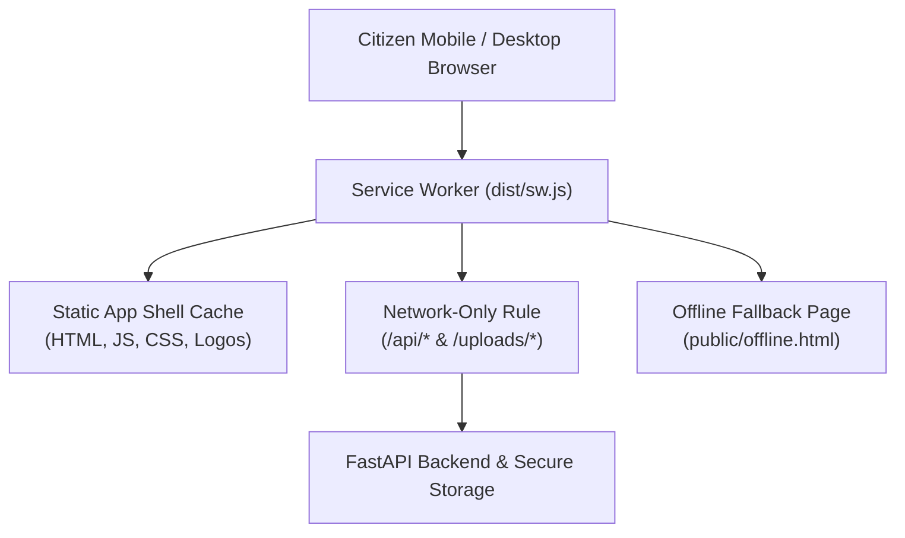

# CivicFix AI — Progressive Web App (PWA) Specification

This document details the Progressive Web App architecture, Web App Manifest, Service Worker caching policies, security protections for citizen data, and offline behavior for CivicFix AI.

---

## 1. Architecture Overview

CivicFix AI is configured as a fully installable, standards-compliant Progressive Web App powered by `vite-plugin-pwa` (Workbox 7):

---

## 2. Web App Manifest & App Identity

The manifest is generated via `frontend/vite.config.ts` and referenced in `frontend/index.html`:

- **Name**: `CivicFix AI — Municipal Complaint Platform`
- **Short Name**: `CivicFix AI`
- **Theme Color**: `#1e3a8a` (Civic Navy)
- **Background Color**: `#f8fafc`
- **Display Mode**: `standalone` (removes browser URL bar when installed)
- **Icons**:
  - `public/icons/icon-192.png` (192x192, any purpose)
  - `public/icons/icon-512.png` (512x512, any purpose)
  - `public/icons/icon-512-maskable.png` (512x512, maskable for Android adaptive icons)
  - `public/favicon.svg` (Scalable vector favicon)

---

## 3. Strict Security & Caching Policy

> [!CAUTION]
> **Strict Privacy Guarantee**: To prevent data leakage across shared municipal devices or public computers, **authenticated API responses, JWT tokens, citizen PII, and complaint evidence are NEVER cached in CacheStorage**.

Workbox runtime caching rules configured in `frontend/vite.config.ts`:

1. **`NetworkOnly` for all API endpoints (`/api/*`)**:
   - Every fetch to the backend requires a live network connection.
   - If offline, requests fail gracefully with structured error handling rather than serving stale or unauthorized private data.
2. **`NetworkOnly` for complaint evidence (`/uploads/*`)**:
   - Photos of damaged infrastructure or citizen homes are never stored in public service worker caches.
3. **`CacheFirst` (with 30-day expiration) for static assets**:
   - Only fingerprinted JavaScript bundles, CSS stylesheets, and Google Fonts are cached.
4. **Offline Fallback (`public/offline.html`)**:
   - When navigation requests fail due to zero connectivity, the browser displays a branded offline screen explaining the network requirement and providing a "Retry Connection" button.

---

## 4. In-App Install Banner & User Experience

CivicFix AI includes an accessible, non-intrusive install banner (`frontend/src/components/common/PWAInstallBanner.tsx`):
- Listens for the browser's `beforeinstallprompt` event.
- Displays a clean floating prompt: *"Install CivicFix AI for faster access to municipal services"*.
- Handles the user's choice gracefully (`accepted` or `dismissed`).
- Persists dismissal in `localStorage` to avoid repeatedly nagging the user.
- Automatically hides if the application is already running in `standalone` mode (`window.matchMedia('(display-mode: standalone)').matches`).

---

## 5. Browser Support & HTTPS Requirements

- **Localhost Development**: Service Workers operate freely on `http://localhost:5173` or `http://127.0.0.1:5173` without TLS certificates.
- **Production Deployment**: Modern browsers (Chrome, Edge, Safari, Firefox) **strictly enforce HTTPS** for Service Worker registration and PWA installation. Production environments must configure valid SSL/TLS certificates (e.g. Let's Encrypt).
- **Push Notifications Notice**: PWA installation enables offline shell caching and desktop/mobile homescreen launching. Web Push Notifications require separate VAPID key pairs and user permission granting (not conflated with PWA installation).

