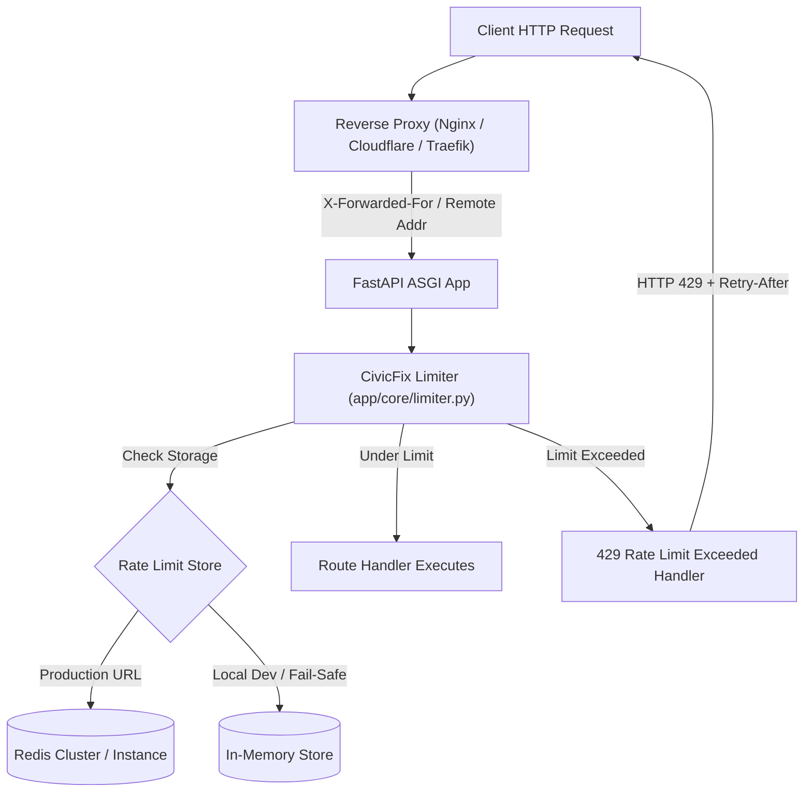

# CivicFix AI — Rate Limiting Specification

This document details the rate limiting architecture, endpoint boundaries, Redis fail-safe mechanisms, and production configuration for CivicFix AI.

---

## 1. Architecture Overview

CivicFix AI uses **SlowAPI** (built on `limits`) integrated at the ASGI application layer to protect authentication and write-intensive endpoints from brute force, denial of service, and resource exhaustion.



---

## 2. Protected Endpoints & Configured Thresholds

All limits are configurable via environment variables without code modification:

| Endpoint | Method | Rate Limit Env Var | Default | Security Objective |
| :--- | :--- | :--- | :--- | :--- |
| `/api/v1/auth/login` | `POST` | `RATE_LIMIT_LOGIN` | `5/minute` | Mitigates credential stuffing and brute-force attacks |
| `/api/v1/auth/register` | `POST` | `RATE_LIMIT_REGISTER` | `3/hour` | Prevents automated spam account creation |
| `/api/v1/auth/refresh` | `POST` | `RATE_LIMIT_LOGIN` | `5/minute` | Guards token refresh cycling |
| `/api/v1/complaints` | `POST` | `RATE_LIMIT_COMPLAINT_CREATE` | `10/hour` | Prevents ticket flooding and database bloat |
| `/api/v1/complaints/{id}/reanalyze-ai` | `POST` | `RATE_LIMIT_AI_ANALYSIS` | `5/hour` | Prevents Gemini AI API quota exhaustion |

---

## 3. Standardized HTTP 429 Response

When any configured rate limit threshold is breached, the application responds with:
- **Status Code**: `HTTP 429 Too Many Requests`
- **Header**: `Retry-After: <seconds>` (calculated dynamic wait time)
- **JSON Body**:
```json
{
  "error": "RATE_LIMIT_EXCEEDED",
  "detail": "Rate limit exceeded: 5 per 1 minute. Please retry after 42 seconds.",
  "retry_after_seconds": 42
}
```

---

## 4. Client IP Resolution & Trusted Proxy Security

To prevent IP spoofing attacks via client-controlled headers:
- When running directly in development or behind a simple port forward, `BEHIND_TRUSTED_PROXY=False`. The limiter inspects `request.client.host` directly, ignoring any injected `X-Forwarded-For` headers.
- When running behind an authorized reverse proxy (e.g. AWS ALB, Nginx, Cloudflare), configure `BEHIND_TRUSTED_PROXY=True`. The helper in `backend/app/core/limiter.py` safely extracts the client IP:
  ```python
  def get_client_ip(request: Request) -> str:
      if settings.BEHIND_TRUSTED_PROXY:
          forwarded_for = request.headers.get("X-Forwarded-For")
          if forwarded_for:
              return forwarded_for.split(",")[0].strip()
      return request.client.host if request.client else "127.0.0.1"
  ```

---

## 5. Storage Strategy & Redis Fail-Safe

1. **Development & Testing**:
   By default, `RATE_LIMIT_STORAGE_URL="memory://"`. Each worker uses a fast, local memory store. In testing fixtures, `limiter._storage.reset()` ensures 100% test isolation.
2. **Multi-Instance Production**:
   Set `RATE_LIMIT_STORAGE_URL="redis://:secret@redis-host:6379/0"`. All instances share rate counters, preventing distributed bypass across load-balanced pods.
3. **Fail-Safe Mechanism**:
   If Redis becomes unreachable (network partition, reboot), CivicFix AI catches connection errors, logs an urgent warning, and **falls back gracefully to memory storage** rather than crashing customer requests.

---

## 6. Configuration Reference

```bash
# Rate Limiting Configuration (.env)
RATE_LIMIT_ENABLED=true
RATE_LIMIT_STORAGE_URL=memory://        # Use redis://redis:6379/0 in production
BEHIND_TRUSTED_PROXY=false             # Set true when behind Nginx / Cloudflare
RATE_LIMIT_LOGIN=5/minute
RATE_LIMIT_REGISTER=3/hour
RATE_LIMIT_COMPLAINT_CREATE=10/hour
RATE_LIMIT_AI_ANALYSIS=5/hour
```

